<!--
  Todo lo que se ve son SVG animados generados con Node desde datos/perfil.json
  (scripts/). Para cambiar algo, edita ese JSON: el workflow "Perfil" vuelve a
  dibujar las tarjetas y este README. La actividad se refresca sola cada día.
-->

<picture><source media="(prefers-color-scheme: dark)" srcset="assets/banner-dark.svg"></picture>
<a href="https://prueba-tecnica-1cs4.vercel.app"><picture><source media="(prefers-color-scheme: dark)" srcset="assets/contacto-web-dark.svg"></picture></a>
<picture><source media="(prefers-color-scheme: dark)" srcset="assets/sobre-mi-dark.svg"></picture>
<picture><source media="(prefers-color-scheme: dark)" srcset="assets/que-hago-dark.svg"></picture>
<picture><source media="(prefers-color-scheme: dark)" srcset="assets/stack-dark.svg"></picture>
<picture><source media="(prefers-color-scheme: dark)" srcset="assets/proyectos-dark.svg"></picture>
<a href="https://prueba-tecnica-1cs4.vercel.app"><picture><source media="(prefers-color-scheme: dark)" srcset="assets/proyecto-portfolio-dark.svg"></picture></a><a href="https://midutch-gamma.vercel.app"><picture><source media="(prefers-color-scheme: dark)" srcset="assets/proyecto-midutch-dark.svg"></picture></a>
<picture><source media="(prefers-color-scheme: dark)" srcset="assets/actividad-dark.svg"></picture>
 Hecho con SVG generados desde <a href="datos/perfil.json"><code>datos/perfil.json</code></a> · la actividad se actualiza sola cada día

